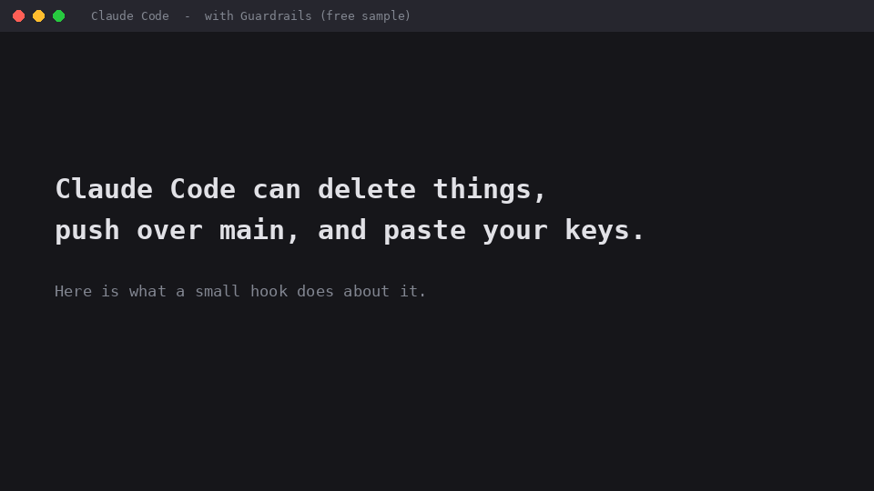

# Claude Code Guardrails (free): command guard + secret blocker + lean Next.js CLAUDE.md



Claude Code will happily run `git push --force origin main`, `rm -rf ~`, or paste your Stripe live key into a source file. These two small hooks stop that. Free, offline, plain Python you can read in five minutes.

## What it stops

**Command Guard Lite** (`hooks/command_guard_lite.py`)

| Blocked | Asks you first | Always allowed |
|---|---|---|
| `rm -rf` on `/`, `~`, `$HOME`, `.`, `*`, `..` | `prisma migrate reset` | `rm -rf node_modules .next dist` |
| `git push --force` to main / master / production | `supabase db reset` | `git push` to a feature branch |
| `DROP DATABASE`, `DROP TABLE`, `TRUNCATE`, `DELETE` with no `WHERE` (in a SQL client) | `drizzle-kit push --force` | `git push --force-with-lease` on your own branch |
| fork bombs, `mkfs`, `dd` to a disk | `terraform destroy`, `git reset --hard` | `grep "DROP TABLE" schema.sql`, `prisma migrate dev` |

**Secret Blocker** (`hooks/secret_blocker.py`)

- Blocks Claude writing a real API key, token or password URL into a source file (OpenAI, Anthropic, Stripe live, AWS, GitHub, Supabase secret / service_role, private keys and more).
- Blocks `git commit` if the staged changes contain one.
- Does **not** flag public keys (Stripe `pk_`, Supabase anon / publishable) or placeholders. Put `guardrails:allow-secret` in a comment to allow one line on purpose.

## Install (2 minutes)

1. Copy the `hooks/` folder into your project as `.claude/hooks/`.
2. Put this in `.claude/settings.json` (merge it with what you already have):

```json
{
  "hooks": {
    "PreToolUse": [
      { "matcher": "Bash",
        "hooks": [ { "type": "command", "command": "python3 \"${CLAUDE_PROJECT_DIR}/.claude/hooks/command_guard_lite.py\"" } ] },
      { "matcher": "Edit|Write|MultiEdit|NotebookEdit|Bash",
        "hooks": [ { "type": "command", "command": "python3 \"${CLAUDE_PROJECT_DIR}/.claude/hooks/secret_blocker.py\"" } ] }
    ]
  }
}
```

On Windows use `python` instead of `python3` (the `python3` name can be a Microsoft Store stub that does nothing).
3. Restart Claude Code in the project, type `/hooks` to confirm they are listed.
4. Test it: ask Claude to run `git push --force origin main`. It should be refused.

Run the tests any time: `python3 tests/test_lite.py` (55 checks).

## Be honest about the limits

- It reads command text. It is a seatbelt, not a vault: unusual commands can get past it. Keep backups and keep production credentials out of your project folder.
- "Asks you first" depends on your permission mode. In bypass-permissions mode there is nobody to confirm.
- If a hook crashes it lets the command through (exit code 1 does not block in Claude Code), so this free version never traps you. The full kit fails more carefully.
- Tested on Linux, Python 3.11 to 3.13, and live inside Claude Code 2.1.304. Windows and macOS are not yet independently tested: if a check fails for you, please open an issue.

## Also included: lean CLAUDE.md for Next.js

`CLAUDE.md` is a trimmed template (about 75 lines): no secrets in `NEXT_PUBLIC_*`, server-only code, safe migrations, tests never weakened, no force-push. Fill in the `[BRACKETS]`.

## Want the rest?

This is the small free part of the **Claude Code Guardrails Kit**. The full kit adds: the complete command guard (dozens of rules for databases, cloud CLIs, git and protected files), file guard so Claude cannot edit `.env` or your guardrails, a **test gate** (Claude can't say "done" while tests fail), rules that survive context compaction, token-saver rules, `/handoff` `/stuck` `/review` commands, a FastAPI template, a one-command installer with a real uninstall, a self-test (`gr_doctor.py`), a log-only dry-run mode, and 188 tests. See the full kit: https://TabishAarif.github.io/claude-code-guardrails/

MIT licensed. Independent project, not affiliated with Anthropic.
